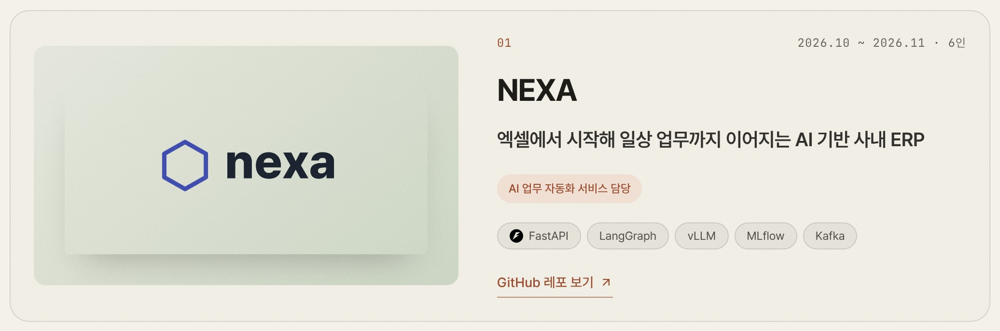
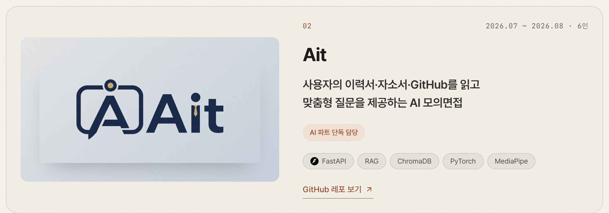
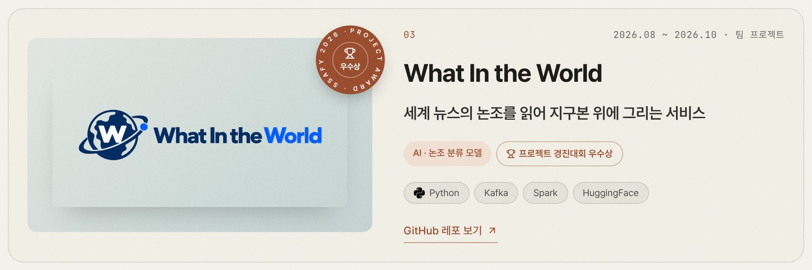
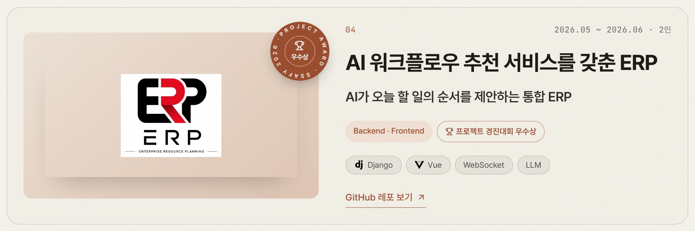
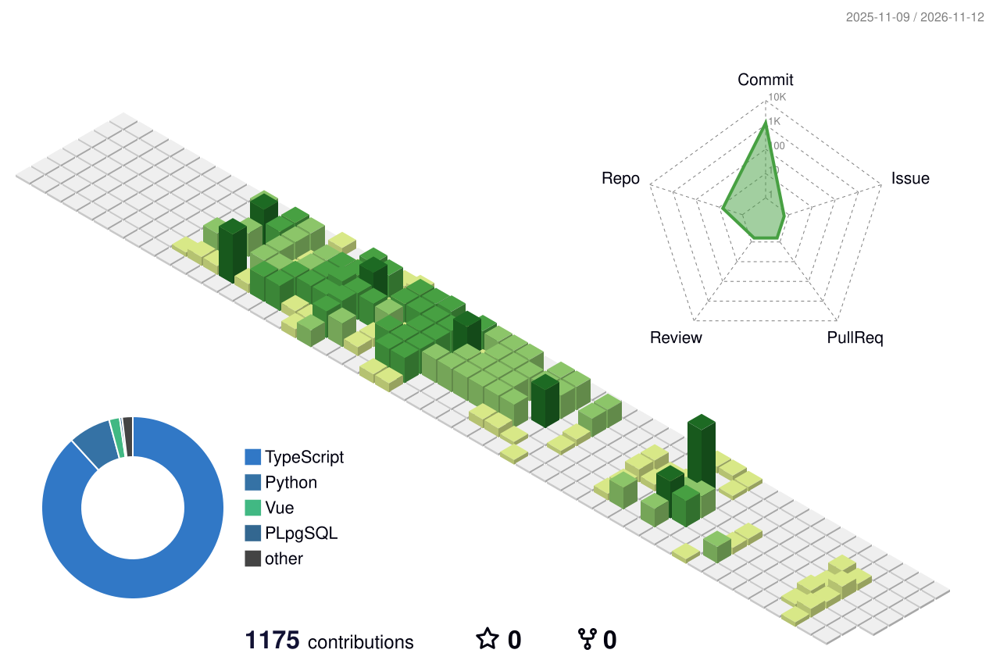

  
  
  
  

---

### 🏆 **Careers**

**2026.01.18 ~ now 15th Samsung SW AI academy For Youth**\
**2026.06.26 [기업 사내 전산 관리를 위한 ERP 시스템] / 🥈우수상 수상 / SSAFY**\
**2026.09.28 [세계 뉴스 논조 분석 시각화 서비스 What In the World] / 🥈우수상 수상 / SSAFY**

---

### 📑  **Certifications**

**2026.03.27 SQL 개발자(SQLD) 취득**\
**2026.06.05 데이터 분석 준전문가(ADsP) 취득**\
**2026.08.29 OPIc IH 등급 취득**\
**2026.09.11 정보처리기사 취득**

---

### ⌨️ **Skills**

  
  
  
  
  
  
  
  

---

### 🌱 **My Garden**

